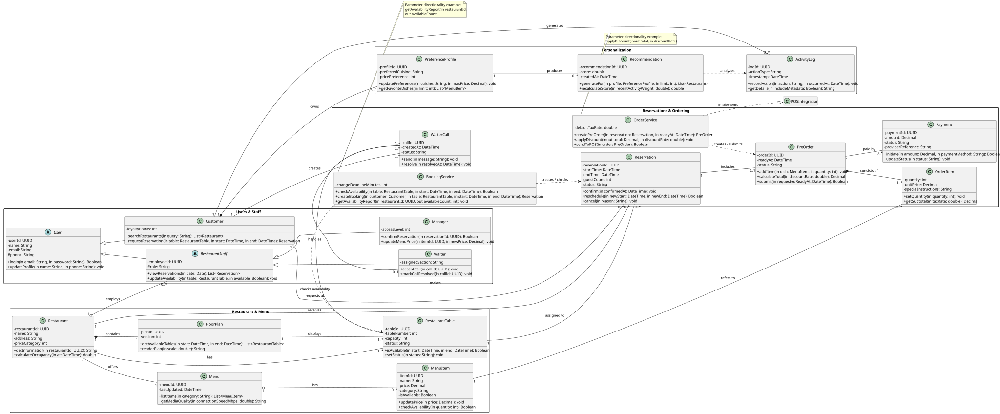
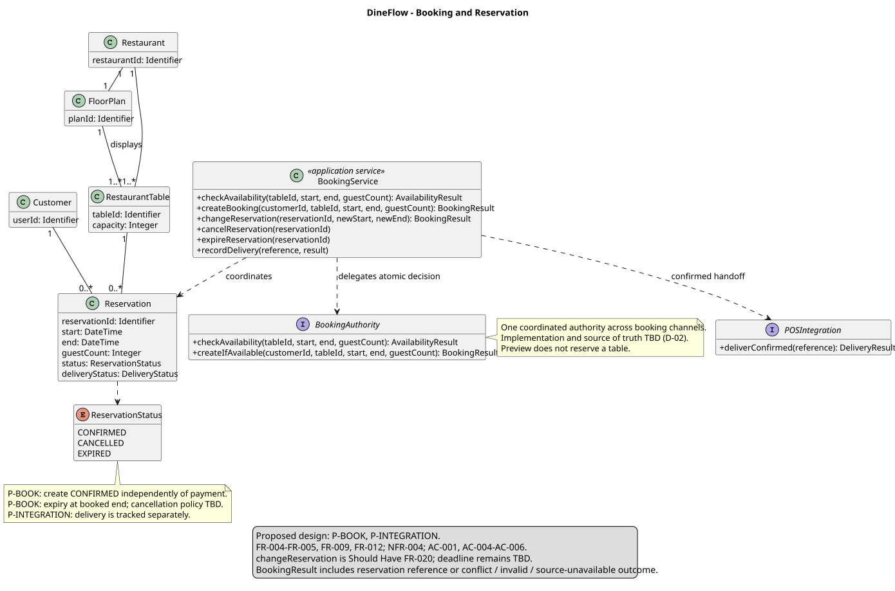
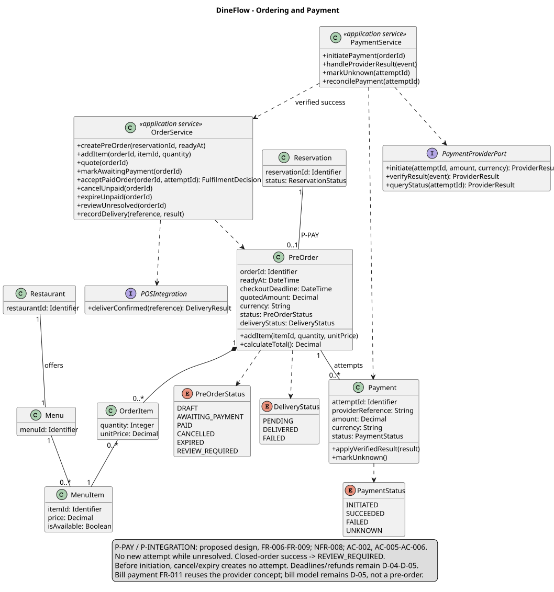
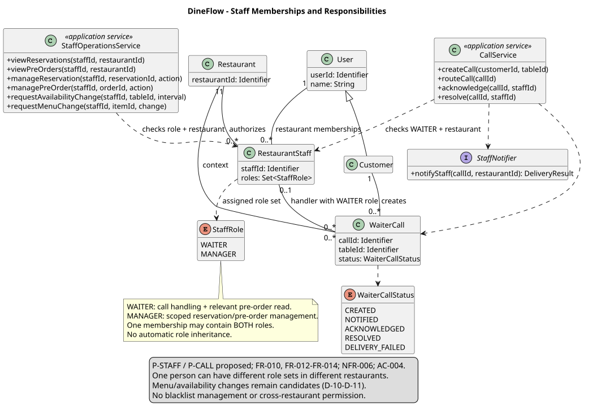

# Class Models

Status: **Proposed logical design.** These models refine the recorded requirements; they are not a database schema, deployment architecture, selected technology stack, or implemented application.

The [functional requirements](../requirements/functional-requirements.md#proposed-lifecycle-model) define the proposed lifecycle vocabulary. The [decision register](../requirements/open-questions.md) records unapproved policies.

## How the top-down design was derived

The starting point was the customer's planned restaurant visit, not a list of UML features. The team first identifies restaurant discovery, reserving a table, arranging food/payment, and requesting service as the business responsibilities in FR-001–FR-014. It then decomposes those responsibilities into objects that carry different facts or lifecycles.

| High-level concept | Decomposition | Reason for the classes/relationships | Supported workflow |
| --- | --- | --- | --- |
| Restaurant and seating | Restaurant, FloorPlan, RestaurantTable, Reservation | A floor plan displays tables; a reservation links a customer and one table to an interval. Table identity/capacity is separate from time-dependent availability. Ordinary associations avoid inventing deletion ownership. | UC-01 discovery; UC-02 atomic booking |
| Planned food and payment | PreOrder, OrderItem, MenuItem, Payment | Items belong to one draft/order, so composition is appropriate. MenuItem remains a referenced product; OrderItem snapshots its quoted price. Payment is an attempt with a provider outcome, not the order itself. | UC-03 draft, checkout exit, payment and late-result handling |
| Restaurant service | User, RestaurantStaff membership, StaffRole, WaiterCall | A person can have a different set of responsibilities in each restaurant. WAITER and MANAGER roles are data on that membership, not employee subclasses that imply inherited permissions. A call has its own receipt/acknowledgement/resolution lifecycle. | UC-04 call handling; UC-05 staff operations |
| Later personalization | ActivityLog, PreferenceProfile, Recommendation | Recorded activity, derived preferences and suggested choices are different facts. They remain Should Have concepts, not extra core booking dependencies. | UC-08, FR-017–FR-019 |

Only after this domain decomposition are coordinating responsibilities assigned to BookingService, OrderService, PaymentService and CallService. Their operations correspond to the sequence messages. Interfaces are introduced where the workflow needs an authoritative booking decision, verified provider result, restaurant acknowledgement or notification receipt.

This is DineFlow's top-down reasoning: workflow responsibility → domain facts and lifecycles → coordinating operations → external contracts. It does not claim that a class diagram proves implementation correctness. Artificial in/out/inout demonstration operations were removed; each retained operation serves a documented scenario.

## General domain model

[Full-size SVG](../../assets/diagrams/class-diagram.svg) · [PlantUML](../../assets/diagrams/source/class-diagram.puml)

This overview shows customer visits, restaurant tables, reservations, pre-orders, line items, payment attempts, and waiter calls. ActivityLog, PreferenceProfile, and Recommendation retain Should Have scope (FR-017–FR-019). Attributes and orchestration operations are deliberately moved to focused views.

Restaurant offers menu items through its menu; the ordering view details that path. Booking and staff views add floor-plan and user-role detail. Multiplicities describe the proposed model, including one pre-order per reservation (P-PAY); they are not independently approved rules.

## Booking and reservation

[Full-size SVG](../../assets/diagrams/booking-class-diagram.svg) · [PlantUML](../../assets/diagrams/source/booking-class-diagram.puml)

Customer makes reservations for RestaurantTable; FloorPlan displays the restaurant's tables. These are ordinary associations because deletion/lifetime ownership is not established. Table capacity is an input to proposed validation, not a global availability Boolean. Availability depends on interval and authoritative reservations.

BookingService coordinates preview, booking creation, proposed changes, and delivery recording. BookingAuthority provides preview and atomic create-if-available; the authority may be DineFlow or restaurant-side (D-02). This contract expresses NFR-004 without choosing locks, a database, or a distributed protocol. changeReservation represents Should Have FR-020; its authority/update contract and deadline remain D-03.

Reservation uses P-BOOK states, with separate P-INTEGRATION delivery status. P-BOOK now proposes cancellation as a separate operation and expiry at the booked end. A confirmed reservation blocks only its finite interval; leaving optional checkout does not silently cancel the visit. Cancellation eligibility and any alternative hold policy still need approval.

**Traceability:** FR-004–FR-005, FR-009, FR-012, FR-020; NFR-004; AC-001, AC-004–AC-006.

## Ordering and payment

[Full-size SVG](../../assets/diagrams/ordering-class-diagram.svg) · [PlantUML](../../assets/diagrams/source/ordering-class-diagram.puml)

PreOrder owns its OrderItems, so composition is meaningful here. A draft may have zero items; submission requires at least one valid item under P-PAY. OrderItem references MenuItem and snapshots the quoted unit price. Menu–MenuItem is an ordinary association; no deletion cascade is assumed.

OrderService coordinates item validation, quoting, order state, and handoff. PaymentService coordinates payment attempts, verified results, and reconciliation. Payment is a domain record of an attempt, not an external provider or an object the customer calls directly.

PaymentProviderPort has explicit initiation, verification, and status-query operations. POSIntegration has an explicit confirmed-information handoff contract. Services depend on these interfaces; OrderService no longer claims to implement POSIntegration. These are logical boundaries supporting AC-006, not a mandate to build separate network services.

PAID order state, SUCCEEDED payment state, and DELIVERED restaurant handoff are different facts. Unknown outcomes prevent a new payment attempt under P-PAY. DRAFT cancellation/expiry before initiation creates no payment attempt. A late successful charge on a closed order/visit records SUCCEEDED but routes the order to REVIEW_REQUIRED, without rebooking or fulfilment. Pricing adjustments, refunds, paid-order modification, and bill ownership remain D-04–D-05. FR-011 is specified separately in UC-06; a pre-order is not silently reused as the whole restaurant bill.

**Traceability:** FR-006–FR-009; FR-011 integration concept only; NFR-005, NFR-008; AC-002, AC-005–AC-006.

## Restaurant staff and operations

[Full-size SVG](../../assets/diagrams/staff-class-diagram.svg) · [PlantUML](../../assets/diagrams/source/staff-class-diagram.puml)

User represents a person; Customer is a customer specialization. RestaurantStaff is now a membership linking that person to one restaurant and a set of StaffRole values. WAITER and MANAGER are independently assignable roles, not mutually exclusive subclasses. A small restaurant may give one membership both roles; a larger venue may assign them to separate people. The same person's membership elsewhere can have different roles.

Permissions are associated with those roles and the active restaurant membership. A WAITER-only employee does not acquire MANAGER powers. No enterprise permission hierarchy or automatic cross-restaurant access is introduced.

CallService coordinates call creation, routing, acknowledgement, and resolution. StaffNotifier distinguishes endpoint receipt from failure; receiving a notification is not human acknowledgement. StaffOperationsService applies the proposed role and restaurant checks before management operations.

Menu/availability change operations are clearly candidate proposals; no existing requirement grants every staff member those permissions. Detailed management transitions remain D-11. Waiter pre-order access is context-only read access, while Manager management is a proposed role allocation. See the [permission matrix](../requirements/functional-requirements.md#proposed-staff-permissions).

**Traceability:** FR-010, FR-012–FR-014, FR-027; NFR-002, NFR-006; AC-004.

## Contract and result interpretation

Identifier and DateTime are logical types, not chosen libraries. AvailabilityResult distinguishes available, unavailable, invalid input, and source unavailable. BookingResult carries either a confirmed reservation reference or conflict/invalid/source-unavailable outcome. ProviderResult distinguishes verified success, verified rejection, and no verified terminal result. DeliveryResult establishes recipient acknowledgement/receipt or a failure to establish delivery. FulfilmentDecision distinguishes eligible PAID from REVIEW_REQUIRED after verified success. cancelUnpaid/expireUnpaid require no unresolved or successful attempt; reviewUnresolved preserves the provider reference when eligibility closes. Exact protocol/error-code formats remain TBD.

The same service/interface operation names appear in the [sequence diagrams](sequence-diagram.md). Supporting validation inside an operation is described by notes, rather than pretending that every validation step is a separate deployed component.

## Review notes

The overloaded original model has been replaced by one domain overview and three focused views. Arbitrary aggregation/ownership is removed; pre-order line-item composition is retained. Undefined POSIntegration is replaced by a real proposed contract, and order orchestration is separated from provider processing.

Unsupported loyalty, tax/discount algorithm and generic login operations remain deferred to D-13. Cancellation and expiry now have explicit proposed safeguards; their business eligibility/deadline values remain open. Meaningful activity/profile/recommendation concepts remain in the overview. Restaurant bill details, staff action transitions, booking ownership, lifecycle policies, and recovery timing remain unresolved.

The [class PNG export](../../assets/diagrams/restaurant-service-class-diagram.png) is regenerated from the same [editable general-model source](../../assets/diagrams/source/class-diagram.puml). It replaces the earlier image-only export; SVG remains the primary scalable rendering. The source guide maps both formats to the maintained source.

[Back to architecture and UML](README.md)
