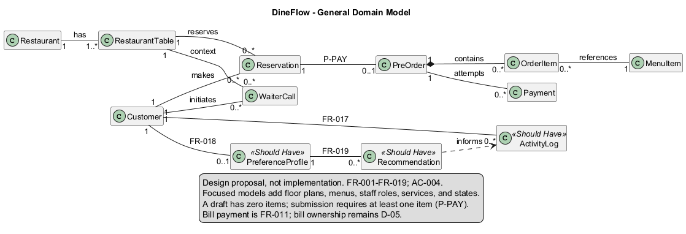

# Class Diagram

Status: **Existing preliminary image available; detailed Lab 6 PlantUML source pending.**

## Purpose

The class model describes system entities, responsibilities, and relationships. This page will present the detailed Lab 6 model after its UML code is supplied and reviewed.

## Existing model

This existing image is preserved without modification. Its relationship to the incoming detailed model has not yet been established.

## Detailed model — Lab 6

The new source and rendered image have not yet been added. Planned files:

- Source: `assets/diagrams/source/class-diagram.puml`
- Image: `assets/diagrams/class-diagram.svg`

After the source is supplied, this section will include the rendered model, a source link, and an explanation of the main class groups and relationships. The existing image will be labelled as a previous version only if the new model supersedes it.

## Related documentation

- [Functional requirements](../requirements/functional-requirements.md)
- [Architectural constraints](../requirements/architectural-constraints.md)
- [Sequence diagram](sequence-diagram.md)

Model elements do not establish additional approved requirements or implementation decisions. Requirement references and unresolved differences will be added when the detailed model is reviewed.

[Back to architecture and UML](README.md)
