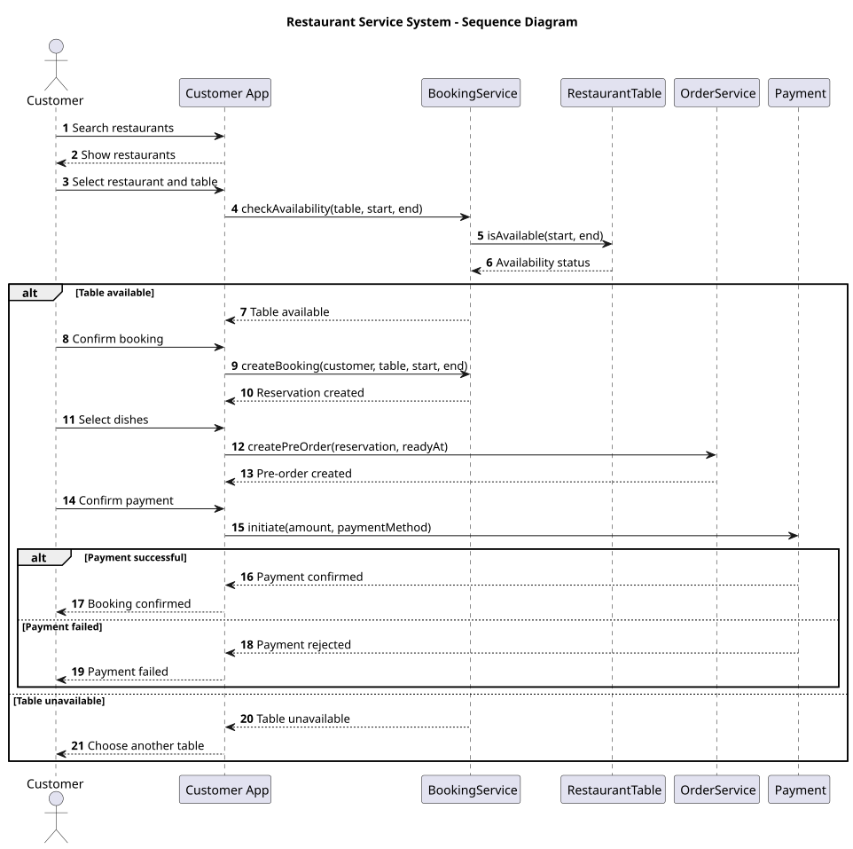
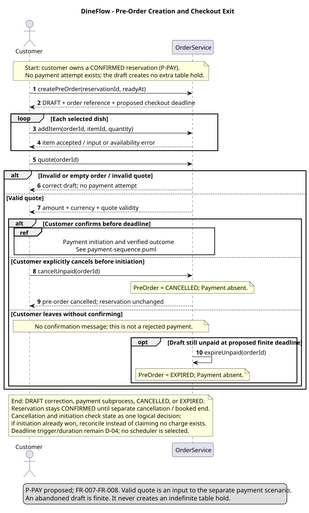
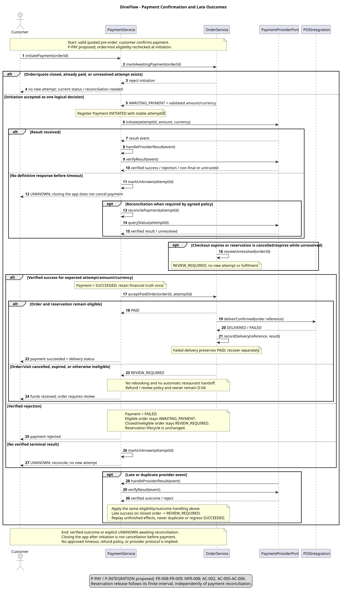
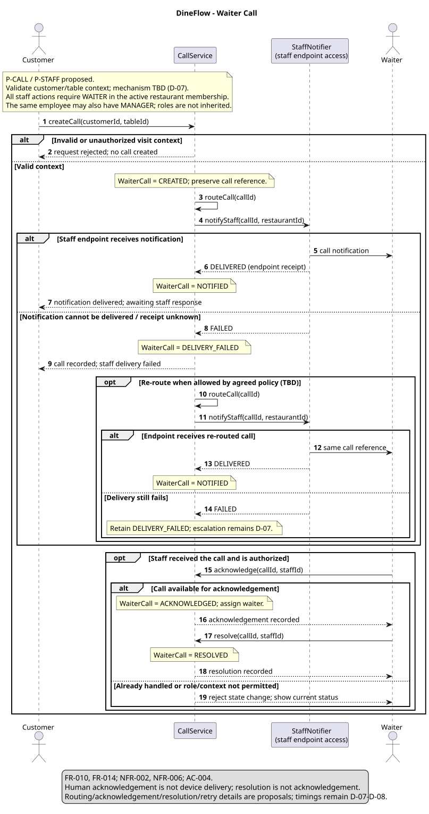

# Sequence Diagrams

Status: **Proposed interaction design.** Four scoped scenarios describe intended behavior, not implemented integrations. Reservation, pre-order creation, payment and waiter-call processing have distinct start/end conditions.

## Design assumptions

- P-BOOK creates a finite CONFIRMED reservation independently of optional prepayment. Its booked end releases the interval; approved cancellation/hold policy remains D-03.
- P-PAY creates a finite draft checkout, distinguishes pre-initiation exits from initiated payment, and preserves verified financial outcomes. Deadline values/triggers and refund policy remain D-04.
- P-INTEGRATION separates business status from acknowledged restaurant handoff. P-CALL distinguishes call creation, notification receipt and staff response.
- P-STAFF uses a role set per employee/restaurant membership. One employee may have both WAITER and MANAGER; neither role automatically inherits the other.
- The [functional requirements](../requirements/functional-requirements.md#proposed-lifecycle-model) own state labels and transition proposals. Numeric deadlines, identity/storage technology and provider protocols are not selected.

## Table reservation

[SVG](../../assets/diagrams/sequence-diagram.svg) · [PlantUML](../../assets/diagrams/source/sequence-diagram.puml)

**Start:** customer has selected table, interval and guest count. **End:** one confirmed finite reservation or explicit rejection/conflict/source failure. **Traceability:** UC-02, FR-004–FR-005, FR-009, NFR-004.

Preview does not reserve the table. BookingAuthority.createIfAvailable performs one coordinated conflict decision and creation across all booking channels. A competing request can win after preview; the loser receives CONFLICT without another reservation. The critical fragment expresses that invariant, not a selected lock/database.

After success, restaurant handoff is tracked separately. Failed handoff does not free the booking. Under revised P-BOOK, the table is blocked only during its booked interval, and the reservation becomes EXPIRED at its end. This does not introduce a permanent payment-dependent hold. Cancellation is a separate authorized operation; policy remains D-03.

## Pre-order and payment

### Pre-order creation and checkout exit

[SVG](../../assets/diagrams/preorder-payment-sequence.svg) · [PlantUML](../../assets/diagrams/source/preorder-payment-sequence.puml)

**Start:** customer owns a CONFIRMED reservation and has no payment attempt for this checkout. **End:** a draft needing correction, entry to the payment subprocess, CANCELLED, or EXPIRED. **Traceability:** UC-03, FR-007–FR-008; P-PAY.

OrderService creates DRAFT, accepts selected items/quantities, and validates a quote. A customer can then:

| Action before initiation | PreOrder | Payment | Reservation |
| --- | --- | --- | --- |
| Confirm a still-valid quote | Enter the separate payment subprocess | Attempt created only by that subprocess | Lifecycle unchanged |
| Explicitly cancel | CANCELLED | No attempt created | Not automatically cancelled |
| Leave without confirming | DRAFT, then EXPIRED at the proposed finite deadline | No attempt created | Not automatically cancelled; booked interval remains finite |

The draft itself never holds extra table capacity. Its finite checkout deadline and trigger require approval; a pre-release policy must assign them rather than leaving abandoned checkouts open forever. Cancellation/expiry and initiation evaluate the same current state as a logical decision. If initiation won the race, reconcile the existing attempt instead of asserting that no charge exists.

## Payment initiation and outcomes

[SVG](../../assets/diagrams/payment-sequence.svg) · [PlantUML](../../assets/diagrams/source/payment-sequence.puml)

**Start:** customer confirms a valid quote. **End:** rejected initiation, a verified terminal financial result, or explicit UNKNOWN awaiting reconciliation/review. **Traceability:** UC-03, FR-008–FR-009, NFR-005/NFR-008; AC-002/AC-005/AC-006.

PaymentService rechecks order, quote, reservation and outstanding-attempt eligibility before registering an attempt. Closing the app after initiation does not cancel the provider's work.

| Event | Payment | PreOrder / resulting action |
| --- | --- | --- |
| Verified success while order/visit remains eligible | SUCCEEDED | PAID; hand off to restaurant and track acknowledgement separately |
| Verified rejection while eligible | FAILED | AWAITING_PAYMENT; permitted retry/cancellation/expiry policy applies |
| Timeout, untrusted or non-final result | UNKNOWN | AWAITING_PAYMENT while eligible; no fresh attempt, query/reconcile |
| Visit cancellation/expiry or checkout deadline while unresolved | Preserve INITIATED/UNKNOWN | REVIEW_REQUIRED; no new attempt or fulfilment |
| Verified late success after cancellation/expiry/ineligibility | SUCCEEDED | REVIEW_REQUIRED; no rebooking or automatic restaurant handoff |
| Verified late rejection for an ineligible order | FAILED | Retain REVIEW_REQUIRED pending agreed closure policy |
| Duplicate/out-of-order result | Apply verified new effects only; never regress SUCCEEDED | Resume unfinished work without duplicate orders/handoffs |

Successful financial processing and permission to fulfil an order are separate facts. Received funds cannot be erased by changing the visit status. Review/refund ownership and eligibility remain unresolved; no automatic refund is invented.

Reconciliation and callback handling use the same eligibility checks. A crash between recording success and updating the order/handoff must be recoverable using the same attempt/business reference. No implementation mechanism is selected.

FR-011 bill settlement remains UC-06 with open bill-source/adjustment rules; it is not silently equated with prepayment.

## Waiter call

[SVG](../../assets/diagrams/waiter-call-sequence.svg) · [PlantUML](../../assets/diagrams/source/waiter-call-sequence.puml)

**Start:** customer requests service in a validated restaurant/table context. **End:** rejected context, explicit delivery failure, or a retained call progressing through staff acknowledgement/resolution. **Traceability:** UC-04, FR-010/FR-014, NFR-002/NFR-006.

CallService routes through StaffNotifier. Endpoint receipt creates NOTIFIED; an employee with WAITER in that restaurant can record ACKNOWLEDGED and then RESOLVED. A MANAGER-only membership does not gain call-handling rights. A dual-role employee can act as Waiter using the same restaurant membership.

Failed/unknown receipt leaves DELIVERY_FAILED and an honest customer-facing result. Conditional re-routing retains the call reference. Timing, no-response escalation and context verification remain D-07–D-08.

## Consistency and source coverage

Service messages correspond to operations in the [class models](class-diagram.md). alt selects alternatives, opt marks conditional actions and loop repeats dish selection; none implies an approved retry count. Important transitions are to be logged under NFR-008 without choosing a logging product.

The earlier combined flow is decomposed rather than duplicated: sequence-diagram is reservation; preorder-payment-sequence is draft/checkout exit; payment-sequence is provider processing; waiter-call-sequence is staff service. Every published SVG/PNG is mapped to a maintained editable source in the [source guide](../../assets/diagrams/source/README.md).

[Use cases](../requirements/use-cases.md) · [Architecture index](README.md)
