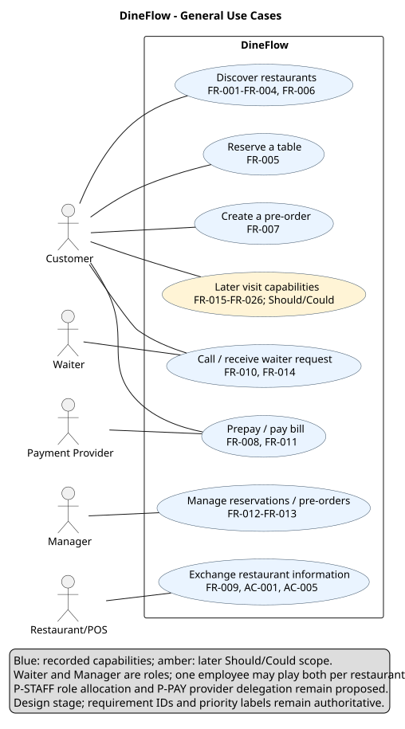
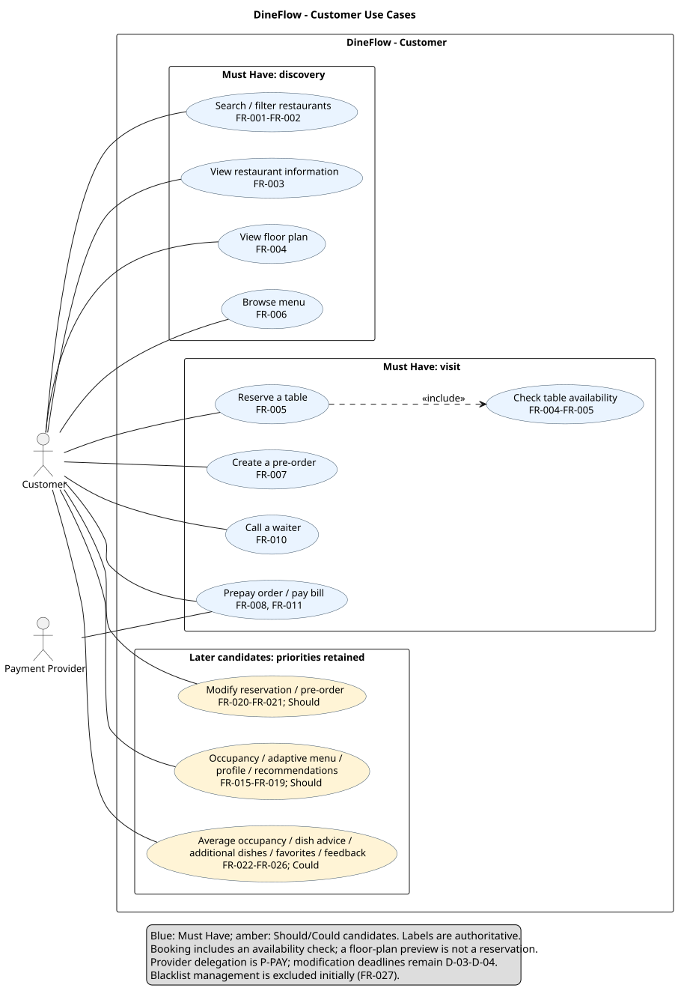
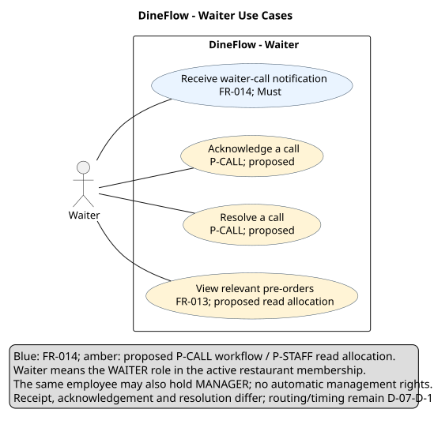
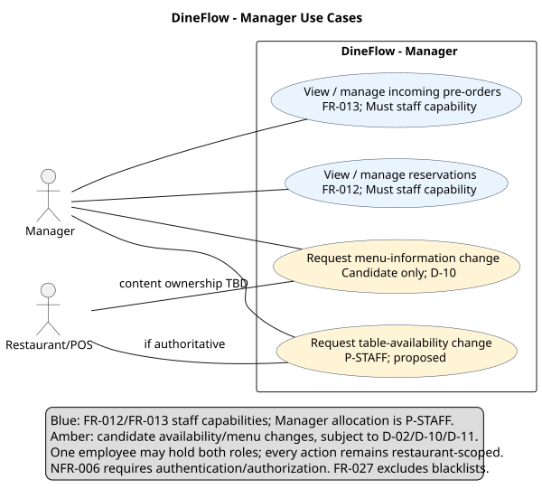

# Use Cases

Status: **Design specification.** The diagrams decompose the same product boundary into overview and role-specific views. They describe recorded capabilities; detailed role allocations, lifecycle policies, and recovery behavior are proposals, not implemented or stakeholder-approved behavior.

Must/Should/Could labels refer to the unchanged [functional requirements](functional-requirements.md). P-BOOK, P-PAY, P-STAFF, P-CALL, and P-INTEGRATION refer to the [proposal register](open-questions.md#proposal-register). Staff management requires authenticated, authorized access (NFR-006). Waiter and Manager are distinct roles: one employee may play both within a restaurant. A WAITER-only assignment never grants MANAGER rights; assignments do not transfer across restaurants.

## General use-case diagram

[Full-size SVG](../../assets/diagrams/use-case-general.svg) · [PlantUML source](../../assets/diagrams/source/use-case-general.puml)

Customer, Waiter, and Manager are human roles. Payment Provider and Restaurant/POS are external actors. The boundary encloses DineFlow responsibilities, not restaurant food preparation or provider internals. The overview groups capabilities; the diagrams below provide detail rather than UML inheritance between diagrams.

## Customer use-case diagram

[Full-size SVG](../../assets/diagrams/use-case-customer.svg) · [PlantUML source](../../assets/diagrams/source/use-case-customer.puml)

Reserve a table includes the necessary availability check. Merely displaying a floor plan is not confirmation. No include/extend relationship is used to imply temporal ordering, optional scope, or navigation. Blue marks recorded capabilities and amber marks proposed workflow details or later scope; written labels preserve meaning without color. Should/Could capabilities remain visibly separate from the Must Have visit flow.

## Waiter use-case diagram

[Full-size SVG](../../assets/diagrams/use-case-waiter.svg) · [PlantUML source](../../assets/diagrams/source/use-case-waiter.puml)

Receiving calls is recorded staff scope. Acknowledging/resolving calls and reading relevant pre-orders are proposed refinements. P-STAFF grants no menu editing, reservation management, payment-result editing, or cross-restaurant access to Waiter.

## Manager use-case diagram

[Full-size SVG](../../assets/diagrams/use-case-manager.svg) · [PlantUML source](../../assets/diagrams/source/use-case-manager.puml)

FR-012/FR-013 require staff management capabilities; assigning these to Manager is P-STAFF. Availability changes depend on booking authority D-02. Menu editing is a candidate capability subject to D-10, not a requirement inferred from viewing menus. Blacklist management remains excluded (FR-027).

## Detailed use-case specifications

The following main flows are intended design specifications. Where a flow chooses a lifecycle, permission, or failure policy beyond the baseline, its proposal is named explicitly. Targets, deadlines, and business rules that remain TBD cannot be treated as agreed acceptance criteria.

### UC-01 — Discover a restaurant

| Field | Specification |
| --- | --- |
| Actor | Customer |
| Preconditions | Restaurant information is available from an agreed source; data ownership/freshness remains D-10. |
| Trigger | Customer searches for a place to visit. |
| Main flow | 1. Enter a search and supported filters. 2. Receive matching restaurants. 3. Select a restaurant. 4. Review restaurant information, floor plan, and menu. 5. Select a visit interval to preview table availability. |
| Alternative flows | No matches: show an empty result and allow filter changes. Invalid filters: identify the invalid input. Information/integration unavailable: show the failure and do not represent missing data as confirmed availability. |
| Postconditions | Customer has information for a possible visit; no reservation or payment has been created. |
| Related requirements | FR-001–FR-004, FR-006; NFR-007, NFR-009–NFR-010 |

### UC-02 — Reserve a table

| Field | Specification |
| --- | --- |
| Actor | Customer; Restaurant/POS participates through the chosen authority/integration boundary. |
| Preconditions | A restaurant, table, and interval are selected; the customer reference and source of booking authority are defined for the scenario. P-BOOK proposes valid interval and table-capacity checks. |
| Trigger | Customer requests confirmation of a selected table and time. |
| Main flow | 1. Preview availability. 2. Customer confirms the request with guest count. 3. BookingService asks BookingAuthority to atomically validate and create if still available. 4. Return a reservation reference and CONFIRMED under P-BOOK. 5. Deliver confirmed information to the restaurant and separately record its acknowledgement/delivery failure under P-INTEGRATION. |
| Alternative flows | Invalid interval/capacity: reject without creating a reservation (proposed validation). Preview unavailable: choose another option. Concurrent winner: return CONFLICT without a second booking. Authority unavailable: report inability to book. Restaurant handoff failed: retain CONFIRMED with failed delivery and expose the recovery need; retry/escalation remain D-06. |
| Postconditions | Either one CONFIRMED reservation exists or the request creates none. Confirmation does not depend on optional prepayment under P-BOOK. Failed delivery does not free a booked table; the booked end releases the interval and moves it to EXPIRED under the proposal. |
| Related requirements | FR-004–FR-005, FR-009; NFR-001, NFR-004, NFR-008; AC-001, AC-004–AC-006 |

[Reservation sequence](../architecture/sequence-diagram.md#table-reservation)

### UC-03 — Create a pre-order and choose whether to pay

| Field | Specification |
| --- | --- |
| Actor | Customer; Payment Provider and Restaurant/POS participate only if payment is initiated. |
| Preconditions | P-PAY proposes an owned CONFIRMED reservation, available menu/pricing data and finite checkout validity. No payment attempt exists at draft creation. |
| Trigger | Customer selects dishes and a ready time for the visit. |
| Main flow | 1. Create DRAFT. 2. Add dishes/quantities. 3. Validate items and quote amount/currency. 4. Customer confirms before the deadline. 5. Recheck eligibility and record INITIATED plus AWAITING_PAYMENT as one logical decision. 6. Verify provider result. 7. If successful and still eligible, record SUCCEEDED/PAID and hand off the paid order. |
| Alternative flows | Invalid items/quote: correct DRAFT. Explicit cancel before initiation: CANCELLED, no Payment record. Leave before initiation: DRAFT until finite proposed deadline, then EXPIRED, no Payment record. Verified rejection: FAILED; eligible order stays AWAITING_PAYMENT. Timeout: UNKNOWN, reconcile, no new attempt. Closing the app after initiation does not cancel payment. Expiry/cancellation while unresolved or verified success after ineligibility: REVIEW_REQUIRED, preserve financial truth, no automatic handoff/rebooking. Duplicate results resume unfinished effects once. Handoff failure retains PAID separately from delivery failure. |
| Postconditions | The current order/payment state is explicit; cancellation and abandonment are distinct from provider rejection. Reservation stays independent and occupies only its finite booked interval. Refund/retry/review policies and deadline values remain D-03–D-06. |
| Related requirements | FR-006–FR-009; NFR-005, NFR-008; AC-002, AC-005–AC-006; P-BOOK/P-PAY refinements are proposed. |

[Draft and checkout exits](../architecture/sequence-diagram.md#pre-order-and-payment) · [Payment outcomes](../architecture/sequence-diagram.md#payment-initiation-and-outcomes)

### UC-04 — Call a waiter and handle the request

| Field | Specification |
| --- | --- |
| Actor | Customer and Waiter |
| Preconditions | Customer is in the restaurant; verifying the visit/table context is D-07. Staff access is authorized for that restaurant. Acknowledgement/resolution are P-CALL/P-STAFF proposals. |
| Trigger | Customer requests waiter assistance. |
| Main flow | 1. Validate context and create a call reference in CREATED. 2. Route to the relevant restaurant staff. 3. Record endpoint receipt as NOTIFIED. 4. Waiter acknowledges the call, becoming the assigned handler; state becomes ACKNOWLEDGED. 5. Waiter provides service and records RESOLVED. |
| Alternative flows | Invalid context: reject without creating a call. Notification failure/unknown receipt: retain DELIVERY_FAILED and tell the customer that delivery failed, without claiming a waiter saw it. Re-route only under an agreed policy. Unauthorized or conflicting acknowledgement: reject the mutation and show the current permitted state. No staff response: escalation remains D-07; no response-time promise is invented. |
| Postconditions | A valid call is retained with its current state and restaurant context. Device receipt, human acknowledgement, and resolution remain distinguishable. |
| Related requirements | FR-010, FR-014; NFR-002, NFR-006, NFR-008; AC-004 |

[Waiter-call sequence](../architecture/sequence-diagram.md#waiter-call)

### UC-05 — Manage restaurant reservations and pre-orders

| Field | Specification |
| --- | --- |
| Actor | Manager as proposed management role; Waiter has proposed context-only pre-order read access. |
| Preconditions | Authenticated staff member has the required role in the active restaurant membership. One employee can hold both roles; a role at another restaurant gives no access. Approved management-action list is still D-11. |
| Trigger | Incoming reservation/pre-order or staff request to review/manage it. |
| Main flow | 1. Select an authorized restaurant context. 2. View incoming reservation/pre-order records. 3. Select a permitted action. 4. Validate current state and authorization. 5. Record the accepted change and show the resulting state. Exact management transitions remain TBD and are not claimed as approved. |
| Alternative flows | Unauthorized/cross-restaurant access: deny without data change. Record changed concurrently: show current state and do not apply a stale action. Availability change: use the common booking authority, never invalidate an existing booking silently. Menu editing: only a candidate pending D-10. Integration unavailable: expose failure/current delivery status. |
| Postconditions | Only a permitted restaurant-scoped action changes data; read access does not imply management permission. Provider payment results cannot be edited by staff. |
| Related requirements | FR-012–FR-014, FR-027; NFR-006, NFR-008; AC-004–AC-005 |

### UC-06 — Pay the restaurant bill

| Field | Specification |
| --- | --- |
| Actor | Customer; Payment Provider; Restaurant/POS |
| Preconditions | Customer is at the restaurant; the correct bill and authoritative amount can be obtained. Bill ownership and adjustment rules remain D-05. |
| Trigger | Customer chooses to settle the restaurant bill by phone. |
| Main flow | 1. Obtain and show the intended bill/amount. 2. Customer selects a supported payment method and confirms. 3. Initiate payment through the proposed provider boundary. 4. Verify the outcome. 5. Show the payment result and reconcile the settlement with the restaurant under the agreed bill contract. |
| Alternative flows | Bill unavailable/changed: do not initiate against an unverified amount. Rejection/unknown outcome: use P-PAY's attempt safeguards; never show a timeout as payment success. Duplicate results: do not settle twice. Partial/split payment, refunds, and bill adjustments remain unspecified. |
| Postconditions | The customer sees the known payment outcome. A successful pre-order payment is not assumed to settle any later restaurant bill. |
| Related requirements | FR-011; NFR-005, NFR-008; AC-002, AC-005 |

This is a baseline scenario with unresolved bill details. The focused payment sequence models UC-03, not a complete bill-settlement integration.

### UC-07 — Modify a reservation or pre-order

| Field | Specification |
| --- | --- |
| Actor | Customer |
| Preconditions | Customer owns the record; FR-020/FR-021 are selected Should Have work. The deadline, editable fields, and paid-order policy must be agreed (D-03–D-04). |
| Trigger | Customer requests an allowed change before the deadline. |
| Main flow | 1. Retrieve current record. 2. Check ownership, allowed state, fields, and deadline. 3. Validate the proposed changes. 4. For booking changes, enforce the same no-overlap invariant. 5. Record the change and update the restaurant as applicable. |
| Alternative flows | Deadline passed/forbidden change: reject. Conflicting booking change: reject and retain the original under P-BOOK. Paid amount difference: block until an approved adjustment policy exists; no automatic refund rule is assumed. Integration failure: retain explicit handoff status. |
| Postconditions | A permitted change is recorded, or the original remains intact under the proposal. |
| Related requirements | FR-020–FR-021; NFR-004, NFR-008; AC-005 |

### UC-08 — Later visit enhancements

| Field | Specification |
| --- | --- |
| Actor | Customer |
| Preconditions | Relevant Should/Could capability is selected for a release and its unresolved rules are agreed. |
| Trigger | Customer views occupancy, receives personalization/advice, orders additional dishes, or records favorites/feedback. |
| Main flow | Perform the selected capability using the current restaurant/customer context. Activity and profiles support recommendations; additional ordering and feedback remain independent optional capabilities. |
| Alternative flows | No profile/history, missing occupancy data, unsupported connection/media, or unavailable dishes: explain missing information and use only an agreed fallback. No invented default recommendation or metric is required. |
| Postconditions | Only selected capabilities produce their intended information or customer record; no priority is promoted by this grouping. |
| Related requirements | FR-015–FR-019 (Should), FR-022–FR-026 (Could), NFR-012 (Could); D-09, D-12 |

## Source-linked PNG export

The [use-case PNG](../../assets/diagrams/restaurant-service-use-case-diagram.png) is regenerated from the [general use-case source](../../assets/diagrams/source/use-case-general.puml), replacing the earlier image-only export. The four diagrams above are the maintained views; no lost-source historical image is presented as an active specification. Blacklist management is excluded initially (FR-027).

[Architecture and UML](../architecture/README.md) · [Class models](../architecture/class-diagram.md)
