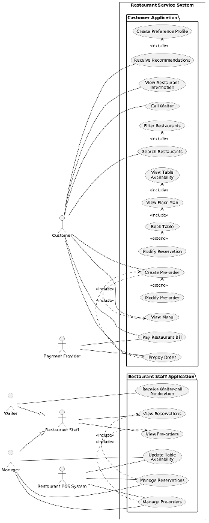

# Use Cases

Status: **Existing diagram available; textual use-case specifications pending**.

This document will describe actor interactions, conditions, and outcomes. The source contains an existing use-case diagram, but no complete textual use-case specification. The template below is intentionally unpopulated.

## Existing source diagram

The image is preserved without modification. Its presence does not confirm detailed flows or change the priorities in the [functional requirements](functional-requirements.md).

## Template for future use cases

| Field | Specification |
| --- | --- |
| Use Case ID | |
| Name | |
| Primary Actor | |
| Preconditions | |
| Main Flow | |
| Alternative Flows | |
| Postconditions | |

## Related UML models

The [class diagram](../architecture/class-diagram.md) describes the system structure. The [sequence diagram](../architecture/sequence-diagram.md) illustrates interactions during booking, pre-ordering, and payment. Both include editable PlantUML sources and rendered SVG images.

[Back to architecture and UML](../architecture/README.md)
